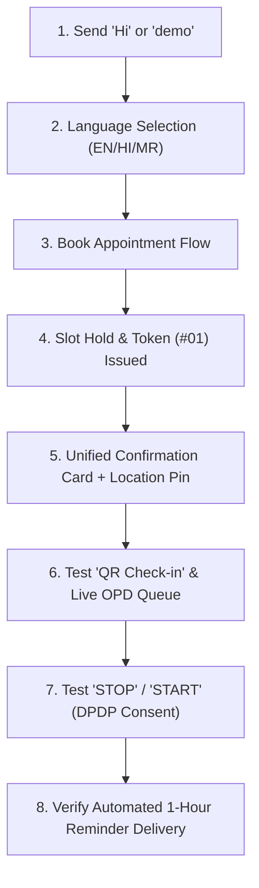

# Svaasth Connect – New Hospital & Business Onboarding Guide

A complete, production-ready guide to onboarding a new hospital, dental clinic, or healthcare enterprise onto the **Svaasth Connect** WhatsApp AI Patient Assistant & PMS platform.

---

## 📋 Table of Contents
1. [Prerequisites & Accounts](#1-prerequisites--accounts)
2. [Meta WhatsApp Cloud API Setup](#2-meta-whatsapp-cloud-api-setup)
3. [Hospital PMS & Database Setup](#3-hospital-pms--database-setup)
4. [Environment Configuration Reference](#4-environment-configuration-reference)
5. [WhatsApp Message Template Setup](#5-whatsapp-message-template-setup)
6. [Hosting & Deployment (Vercel)](#6-hosting--deployment-vercel)
7. [Step-by-Step Go-Live Verification Checklist](#7-step-by-step-go-live-verification-checklist)
8. [Multi-Client Scaling: Architecture Options](#8-multi-client-scaling-architecture-options)
9. [Handling Client-Specific Customizations](#9-handling-client-specific-customizations)
10. [WhatsApp API Limits, Free Tiers & Pricing](#10-whatsapp-api-limits-free-tiers--pricing)
11. [Troubleshooting & Maintenance](#11-troubleshooting--maintenance)

---

## 1. Prerequisites & Accounts

Before beginning the technical setup, ensure you have:

| Item | Requirement | Purpose |
| :--- | :--- | :--- |
| **Meta Business Portfolio** | [business.facebook.com](https://business.facebook.com) | Holds the WhatsApp Business Account (WABA) and system credentials. |
| **Clean Phone Number** | A dedicated mobile or virtual phone number | Must **not** have an active consumer or WhatsApp Business app account. If currently registered, delete the account in the WhatsApp app first. |
| **Meta Developer Account** | [developers.facebook.com](https://developers.facebook.com) | Where the webhook, API keys, and app configurations live. |
| **Convex Account** | [convex.dev](https://convex.dev) | Real-time session state machine, atomic tokens, slot holds, and reminder scheduling. |
| **Hosting Account** | [Vercel](https://vercel.com) (or AWS / GCP) | Next.js webhook endpoints and admin interface. |

---

## 2. Meta WhatsApp Cloud API Setup

### Step 2.1: Create a Meta App
1. Go to [Meta for Developers](https://developers.facebook.com/apps/) ➔ **Create App**.
2. Select **Other** ➔ Select **Business** as the app type.
3. Name your app (e.g. `Svaasth Connect - [Hospital Name]`).
4. Link it to the client hospital's Meta Business Portfolio.
5. In the App Dashboard, find **WhatsApp** and click **Set up**.

### Step 2.2: Add & Verify the Hospital Phone Number
1. Navigate to **WhatsApp** ➔ **API Setup** (or **Configuration**).
2. Under **Step 1: Select phone numbers**, click **Add phone number**.
3. Enter the display name (e.g. `City Care Hospital OPD`) and business category (`Medical & Health`).
4. Enter the clean phone number and verify via **SMS** or **Voice Call OTP**.

### Step 2.3: Generate a Permanent System User Token
> [!IMPORTANT]
> The temporary access token shown on the API Setup page expires after 24 hours. You **must** create a permanent System User Token for production.

1. Open [Meta Business Settings](https://business.facebook.com/settings).
2. Go to **Users** ➔ **System Users** ➔ Click **Add**.
   - **Name**: `SvaasthBot`
   - **Role**: `Admin`
3. Click **Assign Assets**:
   - Under **Apps**, select your WhatsApp App ➔ Toggle **Full Control (Manage App)**.
   - Under **WhatsApp Accounts**, select the WABA ➔ Toggle **Full Control (Manage WhatsApp Business Account)**.
4. Click **Generate New Token**:
   - Select your App.
   - Expiration: **Never**.
   - Check permissions:
     - `whatsapp_business_messaging`
     - `whatsapp_business_management`
5. Copy the generated token string. This is `WHATSAPP_ACCESS_TOKEN`.

### Step 2.4: Configure Webhooks
1. In Meta App Dashboard, go to **WhatsApp** ➔ **Configuration**.
2. Under **Webhook**, click **Edit**:
   - **Callback URL**: `https://<your-deployed-domain>/api/whatsapp/webhook`
   - **Verify Token**: A strong custom secret (e.g. `svaasth_verify_<hospital_id>_2026`).
3. Click **Verify and Save**.
4. Under **Webhook Fields**, click **Manage** and subscribe to:
   - ☑️ **`messages`**

---

## 3. Hospital PMS & Database Setup

### Step 3.1: Initialize Convex Deployments
1. In your project directory, set up the Convex deployment for the new tenant:
   ```bash
   npx convex dev --once
   ```
2. Deploy the schemas and indexes to production:
   ```bash
   npx convex deploy --yes
   ```
3. Verify that the following tables exist in Convex Dashboard:
   - `whatsappSessions`: Patient session state machine and intake drafts.
   - `dailyTokens`: Daily sequential tokens indexed by `(doctorName, date)`.
   - `slotHolds`: 5-minute atomic slot locks indexed by `(doctorName, date, slot)`.
   - `appointmentReminders`: Automated 1-hour advance reminders indexed by `reminderScheduledFor`.
   - `auditLogs`: Compliance event tracking.
   - `processedMessages`: Webhook deduplication to prevent replay attacks.

---

## 4. Environment Configuration Reference

Create `.env.local` on the server / add these environment variables in Vercel:

```env
# =============================================================================
# 1. HOSPITAL IDENTITY & BRANDING
# =============================================================================
HOSPITAL_NAME="City Care Hospital"
HOSPITAL_CITY="Nagpur"
HOSPITAL_ADDRESS="Plot 12, Wardha Road, Dhantoli, Nagpur - 440012"
HOSPITAL_PHONE="0712-2550100"
HOSPITAL_MAP_LINK="https://maps.google.com/?q=21.1340,79.0800"
HOSPITAL_LATITUDE=21.1340
HOSPITAL_LONGITUDE=79.0800
BOT_NAME="City Care Svaasth Bot"

# =============================================================================
# 2. WHATSAPP CLOUD API CREDENTIALS
# =============================================================================
WHATSAPP_ACCESS_TOKEN=EAAbN...[Permanent System User Token]...
WHATSAPP_PHONE_NUMBER_ID=109283746501928
WHATSAPP_BUSINESS_ACCOUNT_ID=981273645019283
WHATSAPP_VERIFY_TOKEN=svaasth_verify_citycare_2026
WHATSAPP_APP_SECRET=[Meta App Secret from App Settings > Basic]

# =============================================================================
# 3. CONVEX DATABASE ENDPOINTS
# =============================================================================
NEXT_PUBLIC_CONVEX_URL=https://[tenant-deployment].convex.cloud
NEXT_PUBLIC_CONVEX_SITE_URL=https://[tenant-deployment].convex.site
CORTEX_CONVEX_URL=https://[pms-deployment].convex.cloud

# =============================================================================
# 4. SECURITY & STAFF AUTHENTICATION
# =============================================================================
ADMIN_API_SECRET=sec_adm_[random_32_chars]
STAFF_SESSION_SECRET=sec_stf_[random_32_chars]
CORTEX_PRESCRIPTION_WEBHOOK_SECRET=sec_rx_[random_32_chars]

# =============================================================================
# 5. OPTIONAL DEV GUARDS
# =============================================================================
# RESTRICT_DEV_RECIPIENT=true
# ALLOWED_DEV_PHONES=919876543210,919123456789
```

---

## 5. WhatsApp Message Template Setup

Under WhatsApp policy, free-form text messages can only be sent within the **24-hour customer service window** (after the patient initiates a chat). For appointment reminders scheduled days or weeks in advance, Meta requires an approved **Utility Template**.

### Template Submission in Meta Business Manager
1. In Meta WhatsApp Manager, navigate to **Account Tools** ➔ **Message Templates** ➔ **Create Template**.
2. Configure:
   - **Category**: `Utility`
   - **Name**: `svaasth_opd_update`
   - **Language**: `English (US)` (`en_US`)
3. **Body Text**:
   ```text
   Hello {{1}}, this is an automated reminder regarding your OPD token #{{2}} with {{3}} scheduled on {{4}}. Please arrive 15 minutes before your slot time for registration and vitals check.
   ```
4. **Sample Values**:
   - `{{1}}`: `Rahul Sharma`
   - `{{2}}`: `04`
   - `{{3}}`: `Dr. Nilesh Patil`
   - `{{4}}`: `18/11/2026 at 10:30 AM`
5. Submit for approval (utility templates are typically approved within 5–15 minutes).

---

## 6. Hosting & Automated Reminders Setup (cron-job.org)

1. Push your client repository to GitHub.
2. In Vercel, click **Add New Project** ➔ Import the repository.
3. In **Environment Variables**, paste all the variables from Section 4.
4. Click **Deploy**.

### Setting Up Free 5-Minute Automated Reminders (cron-job.org)
On Vercel's free tier, internal cron schedules shorter than once per day are restricted. Use the free industry-standard **[cron-job.org](https://cron-job.org)**:
1. Create a free account at [cron-job.org](https://cron-job.org).
2. Click **Create Cronjob**:
   - **Title**: `Svaasth 1-Hour Reminder Dispatcher`
   - **URL**: `https://<your-deployed-domain>/api/whatsapp/reminders` (e.g. `https://whatsapp-black-sigma.vercel.app/api/whatsapp/reminders`)
   - **Schedule**: Execution schedule ➔ **Every 5 minutes** (or `*/5 * * * *`).
   - **HTTP Method**: `GET`
3. Click **Create**.
4. Every 5 minutes, cron-job.org will ping the endpoint, and Svaasth Connect will automatically detect and dispatch all 1-hour advance reminders!

---

## 7. Step-by-Step Go-Live Verification Checklist

Run through this test sequence on the live WhatsApp number:



- [ ] **1. Greeting & Language**: Message `Hi` ➔ Verify 3 language buttons appear (`English`, `हिंदी`, `मराठी`).
- [ ] **2. Doctor & Slot Availability**: Select a doctor ➔ Confirm morning & evening session slots display dynamically.
- [ ] **3. Slot Hold & Concurrency**: While one phone is holding a slot, attempt to select the same slot from a second phone ➔ Confirm second user is notified slot is reserved.
- [ ] **4. Booking Receipt & Location**: Complete intake ➔ Confirm single interactive receipt with `➕ Book 2nd Person`, `📅 View Appointments`, and `🏠 Main Menu` arrives, followed by the hospital location pin.
- [ ] **5. Daily Token Sequence**: Verify tokens start at `#01` and increment consecutively for that doctor on that date.
- [ ] **6. Multi-Profile Check-in**: For a phone with multiple family members registered, type `check in` ➔ Confirm interactive buttons appear asking to select which patient is arriving.
- [ ] **7. Live Queue**: Click `Live Queue` ➔ Confirm real-time count of waiting patients and currently consulting token.
- [ ] **8. DPDP Compliance**: Text `STOP` ➔ Confirm opt-out notice and reminder cancellation. Text `START` ➔ Confirm notifications re-enabled.
- [ ] **9. Staff Handover**: In admin dashboard, verify conversations are visible and handover toggle pauses the bot cleanly for manual receptionist replies.

---

## 8. Multi-Client Scaling: Architecture Options

When selling Svaasth Connect to multiple hospitals, choose between two deployment strategies:

### Option A: 1 Git Repo ➔ Multiple Vercel Projects (Recommended for 1–5 Clients)
Keep **one single GitHub repository**. In Vercel, create separate projects (`svaasth-cortex`, `svaasth-apollo`) pointing to the **same Git repo**, each configured with its own hospital-specific `.env` variables and Convex database.
- **Pros**: 100% data and HIPAA/DPDP isolation, 5-minute setup per client, zero refactoring needed today. A single `git push origin main` deploys updates and bugfixes across all clients simultaneously.
- **Cons**: Managing 10+ distinct projects in the Vercel dashboard becomes repetitive.

### Option B: True Multi-Tenant SaaS (1 Git Repo ➔ 1 Vercel Project)
Run **one single Vercel deployment** (`api.svaasth.com`) connected to a central multi-tenant database.
- **How Webhooks Route Automatically**: Meta sends incoming messages with `entry[0].changes[0].value.metadata.phone_number_id`. Your backend looks up which hospital owns that phone number ID in a `hospitals` database table and executes the conversation turn in that hospital's context.
- **How Custom Domains Route**: Multiple custom domains (`cortex.svaasth.com`, `admin.apollohospital.com`) point to the same Vercel project via CNAME. Next.js `middleware.ts` inspects `request.headers.get('host')` and dynamically serves the corresponding hospital's dashboard branding, doctors, and reports.
- **Onboarding Speed**: Onboarding client #6 or #50 takes under 2 minutes by filling out a form in your Super-Admin portal—no code commits or deployments required.

---

## 9. Handling Client-Specific Customizations

When different hospitals request custom features or business logic, follow these best practices:

1. **Config Toggles & Feature Flags (90% of requests)**:
   Add boolean flags to environment variables or the hospital database record (e.g. `ENABLE_PAYMENTS=false`, `SLOT_DURATION_MINUTES=30`, `REQUIRE_ADDRESS=false`). Keep all clients on the exact same codebase so any feature built for one hospital can easily be monetized and activated for others.
2. **Client-Specific Git Branches (For radical one-off overhauls)**:
   If a client pays a premium for bespoke custom flows, branch from `main` (`git checkout -b client/apollo-custom`). Set their Vercel project's production branch to that branch. Pull core bugfixes into their branch anytime with `git merge main`.
3. **Modular Adapters (For differing PMS backends)**:
   Define a unified `PMSAdapter` interface (`getAvailableSlots`, `bookAppointment`, `getPatientRecords`). Switch between Cortex, Practo, or custom hospital ERP backends using `PMS_PROVIDER=cortex` or `PMS_PROVIDER=practo`.

---

## 10. WhatsApp API Limits, Free Tiers & Pricing

Understanding Meta's WhatsApp Cloud API commercial parameters is essential for budgeting and client billing:

### Free Tier Allocation
- Every Meta WhatsApp Business Account (WABA) receives **1,000 Free Service Conversations every calendar month**.
- A **Service Conversation** is a user-initiated interaction (patient texts the hospital first). All back-and-forth messages within a **24-hour window** count as **1 conversation**.
- For a clinic managing 20–30 patient bookings daily, this monthly free allowance covers almost the entire consultation volume at ₹0 cost.

### Commercial Rates Beyond 1,000 Conversations (India Pricing)
Charges are billed per 24-hour conversation window (never per individual message):

| Conversation Type | Initiator | Description | Approx Cost (India) |
| :--- | :--- | :--- | :--- |
| **Service** | Patient | Patient initiates consultation, booking, or report query | **~₹0.30 to ₹0.35** / 24h |
| **Utility** | Hospital | Automated 1-hour appointment reminder outside 24h window | **~₹0.12 to ₹0.15** / conversation |
| **Marketing** | Hospital | Health checkup promotions, seasonal wellness announcements | **~₹0.70 to ₹0.78** / conversation |

### Volume Limits (Meta Tier System)
Meta limits the number of unique customers a hospital can initiate messages to in a rolling 24-hour window:
- **Unverified Account**: 250 unique users / day.
- **Tier 1 (Verified Business)**: 1,000 unique users / day.
- **Tier 2**: 10,000 unique users / day.
- **Tier 3**: 100,000 unique users / day.
- **Tier 4**: Unlimited unique users / day.
*(Incoming messages from patients are completely unlimited across all tiers; Meta automatically scales tiers up based on high message quality and low block rates).*

### Throughput Capacity
WhatsApp Cloud API supports **80 messages per second** (sent + received combined), accommodating high-volume hospital rushes and emergency dispatch without throttling.

---

## 11. Troubleshooting & Maintenance

| Symptom | Probable Cause | Resolution |
| :--- | :--- | :--- |
| **Bot not responding to any messages** | Webhook verification failed or invalid secret | Check Vercel logs. Ensure `WHATSAPP_ACCESS_TOKEN` is valid and the Webhook URL in Meta points to `https://<domain>/api/whatsapp/webhook`. |
| **Messages fail with `(#131047) Re-engagement message`** | Outbound message sent outside 24-hr window without template | Ensure `svaasth_opd_update` template is approved in Meta WABA and matches the template name in `lib/whatsapp.ts`. |
| **Token counter not incrementing** | Deployment index mismatch | Run `npx convex deploy --yes` to ensure `dailyTokens` table and `by_doc_date` index exist on production Convex. |
| **Prescription link gives invalid signature** | Secret mismatch | Ensure `CORTEX_PRESCRIPTION_WEBHOOK_SECRET` matches between WhatsApp repo and Cortex PMS. |
